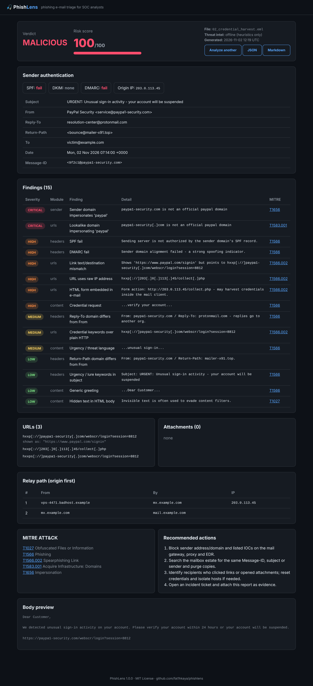
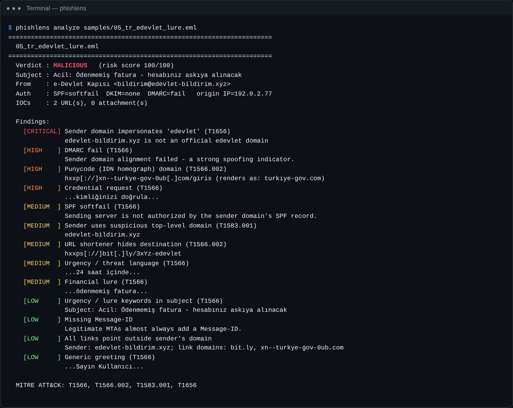
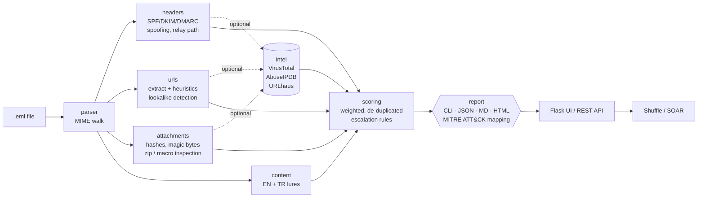
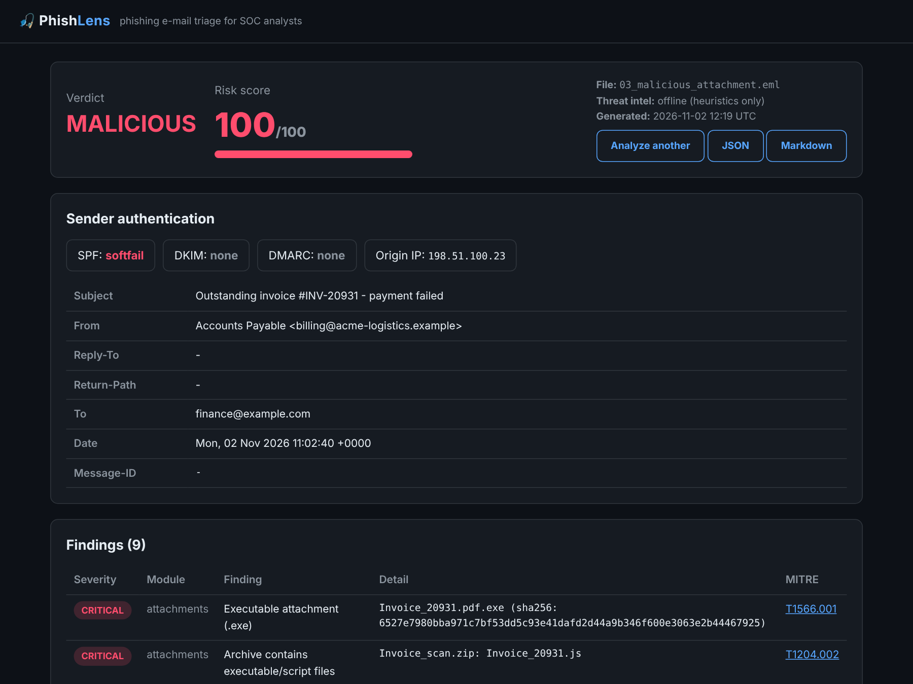

<div align="center">

# 🎣 PhishLens

**Phishing e-mail analyzer for SOC triage**

Drop in a suspicious `.eml` and get a verdict, a 0–100 risk score, defanged IOCs and a MITRE ATT&CK-mapped report in seconds. You can use it from the CLI, the web UI or a JSON API that plugs into SOAR.

[](https://github.com/fat1hkaya/phishlens/actions/workflows/ci.yml)


🇹🇷 [Türkçe README](README.tr.md)



</div>

---

## Why

User-reported phishing is one of the most frequent alert types in a Security Operations Center. Triage is repetitive: read the headers, check SPF/DKIM/DMARC, pull out every link and attachment, hash them, look them up, decide, and write it up. **PhishLens automates that first pass** so the analyst starts from a structured, evidence-backed report instead of raw MIME.

## Features

| Area | What it checks |
|---|---|
| **Header forensics** | SPF / DKIM / DMARC verdicts (`Authentication-Results`, `Received-SPF`), From vs Reply-To vs Return-Path mismatch, display-name spoofing, authority names from free webmail, missing Message-ID, `Received` relay path and originating public IP |
| **Sender domain** | Brand lookalikes (homoglyphs `0→o`, `rn→m`, Levenshtein ≤ 2), punycode/IDN homographs, risky TLDs, display name claiming a brand from an unrelated domain |
| **URLs** | Text and HTML extraction, **anchor-text vs real destination mismatch**, raw IP hosts, shorteners, punycode, `@` in authority, excessive subdomains, credential keywords over HTTP, direct executable downloads, embedded HTML `<form>` |
| **Attachments** | MD5 / SHA1 / SHA256, true type by **magic bytes** (PE, ELF, LNK, ISO, OLE2, ZIP…), dangerous extensions, double extensions, RTLO trick, extension/content mismatch, HTML/SVG smuggling, VBA macros in OOXML, executables inside ZIPs, encrypted archives |
| **Content** | Social-engineering language in **English and Turkish**: credential requests, urgency/threats, financial lures, BEC phrasing, generic greetings, hidden HTML text |
| **Threat intel** *(optional)* | VirusTotal (hashes, URLs), AbuseIPDB (origin IP), URLhaus (URLs). Opt-in via API keys, rate-limit friendly, fails gracefully |
| **Scoring** | Weighted, de-duplicated findings → `LIKELY SAFE` / `SUSPICIOUS` / `MALICIOUS`, with escalation rules (auth failure + critical indicator ⇒ malicious) |
| **Reporting** | Terminal summary, JSON, Markdown and standalone HTML. IOCs are always **defanged** (`hxxps[://]evil[.]com`). Every finding is mapped to **MITRE ATT&CK** and each verdict comes with recommended response actions |
| **Integration** | `POST /api/analyze` JSON endpoint for Shuffle / TheHive / any SOAR; CLI exit codes `0/1/2` for scripting |

## Quick start

```bash
git clone https://github.com/fat1hkaya/phishlens.git
cd phishlens
python -m venv .venv && source .venv/bin/activate   # Windows: .venv\Scripts\activate
pip install -e .

phishlens analyze samples/02_credential_harvest.eml
```



### CLI

```bash
phishlens analyze suspicious.eml                       # coloured terminal summary
phishlens analyze suspicious.eml -f json | jq .verdict # machine-readable
phishlens analyze inbox/*.eml -f html -o reports/      # batch → one HTML report per mail
phishlens analyze suspicious.eml --online              # + VirusTotal / AbuseIPDB / URLhaus
phishlens web --port 5000                              # web interface
```

Exit codes: `0` likely safe · `1` suspicious · `2` malicious · `3` input error.

### Web UI and API

```bash
phishlens web            # http://127.0.0.1:5000
```

```bash
curl -s -F eml=@suspicious.eml http://127.0.0.1:5000/api/analyze | jq '{verdict, score, mitre_techniques}'
```

### Docker

```bash
cp .env.example .env      # optionally add API keys
docker compose up -d --build
# → http://127.0.0.1:5000
```

### Threat-intel keys (optional)

| Variable | Provider | Free tier |
|---|---|---|
| `VT_API_KEY` | [VirusTotal](https://www.virustotal.com/gui/my-apikey) | 4 req/min |
| `ABUSEIPDB_API_KEY` | [AbuseIPDB](https://www.abuseipdb.com/account/api) | 1 000 checks/day |
| `URLHAUS_API_KEY` | [abuse.ch URLhaus](https://auth.abuse.ch/) | free |

Without keys PhishLens works fully offline using heuristics only, so no mail content ever leaves the host.

## Architecture



```
phishlens/
├── parser.py        # MIME parsing → bodies + attachments
├── headers.py       # auth results, sender consistency, Received hops
├── urls.py          # URL extraction, lookalike/homograph detection, sender-domain checks
├── attachments.py   # hashing, file-type detection, archive & macro inspection
├── content.py       # social-engineering language (EN/TR)
├── intel.py         # VirusTotal, AbuseIPDB, URLhaus clients
├── scoring.py       # risk score & verdict
├── report.py        # JSON / Markdown / HTML renderers + MITRE names
├── cli.py           # `phishlens` command
└── web/             # Flask app + Jinja templates
```

## Sample results

The `samples/` folder contains **synthetic, harmless** e-mails (generated by `samples/generate_samples.py`, documentation-range IPs, placeholder attachments). Full reports are in [`docs/example-reports/`](docs/example-reports/).

| Sample | Scenario | Verdict | Score |
|---|---|---|---|
| `01_legit_newsletter.eml` | Authenticated newsletter | 🟢 LIKELY SAFE | 0 |
| `02_credential_harvest.eml` | PayPal lookalike, DMARC fail, link mismatch, embedded form | 🔴 MALICIOUS | 100 |
| `03_malicious_attachment.eml` | `Invoice.pdf.exe`, ZIP with `.js`, `.xlsm` | 🔴 MALICIOUS | 100 |
| `04_bec_ceo_fraud.eml` | CEO display-name spoof from Gmail, gift-card request | 🟠 SUSPICIOUS | 49 |
| `05_tr_edevlet_lure.eml` | Turkish e-Devlet lure, punycode `turkıye-gov.com`, bit.ly | 🔴 MALICIOUS | 100 |



## Detection logic

See [`docs/detection-logic.md`](docs/detection-logic.md) for every rule, its weight and its ATT&CK mapping, and [`docs/shuffle-integration.md`](docs/shuffle-integration.md) to wire PhishLens into a SOAR phishing-response playbook.

## Development

```bash
pip install -e ".[dev]"
pytest --cov=phishlens      # 42 tests, ~90 % coverage
ruff check .
python samples/generate_samples.py
```

CI (GitHub Actions) runs lint, tests on Python 3.10–3.13, a CLI smoke test and a Docker build with an API health check.

## Roadmap

- [ ] `.msg` (Outlook) support
- [ ] urlscan.io screenshot of landing pages
- [ ] QR-code ("quishing") extraction from images and PDFs
- [ ] YARA scanning of attachments
- [ ] Export IOCs as STIX 2.1 / MISP event
- [ ] IMAP mailbox polling mode for a shared "report phishing" inbox

## Disclaimer

PhishLens is a triage aid, not a replacement for analyst judgement or a sandbox. Heuristic scores can produce false positives and false negatives. Only analyze e-mails you are authorized to handle.

## License

[MIT](LICENSE) © 2026 Fatih Kaya · [LinkedIn](https://www.linkedin.com/in/fatihsec) · [GitHub](https://github.com/fat1hkaya)
