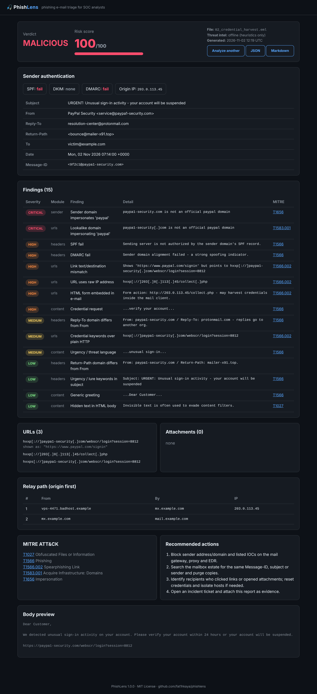
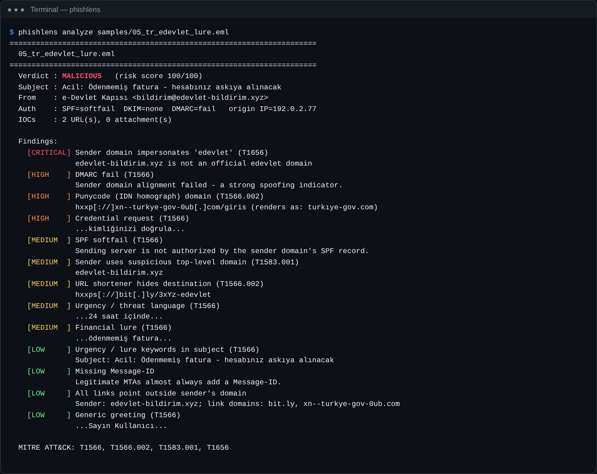
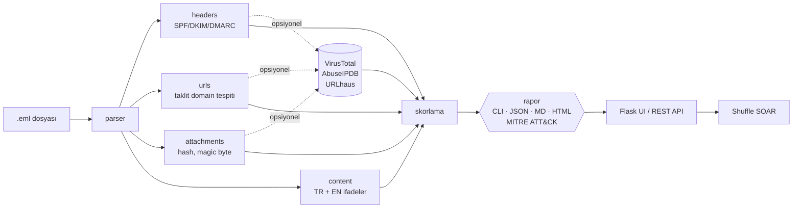

<div align="center">

# 🎣 PhishLens

**SOC triage için oltalama (phishing) e-posta analiz aracı**

Şüpheli bir `.eml` dosyasını verdiğinizde birkaç saniye içinde karar, 0–100 arası risk skoru, defang edilmiş IOC'ler ve MITRE ATT&CK ile eşlenmiş bir rapor alırsınız. CLI, web arayüzü veya SOAR'a bağlanabilen JSON API üzerinden kullanılabilir.

🇬🇧 [English README](README.md)



</div>

---

## Neden?

Kullanıcıların bildirdiği phishing e-postaları, bir Güvenlik Operasyonları Merkezi'nde (SOC) en sık gelen alarm tiplerinden biridir. İnceleme süreci tekrarlıdır: header'ları oku, SPF/DKIM/DMARC'a bak, tüm linkleri ve ekleri çıkar, hash'le, sorgula, karar ver, raporla. **PhishLens bu ilk geçişi otomatikleştirir.** Böylece analist ham MIME yerine yapılandırılmış ve kanıta dayalı bir raporla başlar.

## Özellikler

| Alan | Kontroller |
|---|---|
| **Header analizi** | SPF / DKIM / DMARC sonuçları, From – Reply-To – Return-Path uyumsuzluğu, görünen ad (display name) sahteciliği, ücretsiz mail sağlayıcısından gelen "IT Destek" gibi otorite isimleri, eksik Message-ID, `Received` atlama yolu ve kaynak public IP |
| **Gönderen domain** | Marka taklidi (`0→o`, `rn→m` homoglyph'leri, Levenshtein ≤ 2), punycode/IDN homograph, riskli TLD'ler, alakasız bir domainden gelip marka adı kullanan görünen ad |
| **URL'ler** | Metin ve HTML'den çıkarma, **link metni ile gerçek hedefin uyuşmaması**, IP adresli URL, kısaltıcılar, punycode, `@` hilesi, aşırı subdomain, HTTP üzerinden giriş sayfası, doğrudan çalıştırılabilir dosya indirme, mail içine gömülü `<form>` |
| **Ekler** | MD5 / SHA1 / SHA256, **magic byte** ile gerçek dosya tipi (PE, ELF, LNK, ISO, OLE2, ZIP…), tehlikeli uzantılar, çift uzantı (`fatura.pdf.exe`), RTLO hilesi, uzantı–içerik uyumsuzluğu, HTML/SVG smuggling, OOXML içinde VBA makro, ZIP içinde script/exe, şifreli arşiv |
| **İçerik** | **Türkçe ve İngilizce** sosyal mühendislik ifadeleri: kimlik/şifre doğrulama isteği, aciliyet ve tehdit, finansal yem, BEC (CEO dolandırıcılığı) kalıpları, "Sayın Müşterimiz" gibi genel hitaplar, gizli HTML metni |
| **Tehdit istihbaratı** *(opsiyonel)* | VirusTotal (hash, URL), AbuseIPDB (kaynak IP), URLhaus (URL). API anahtarı varsa devreye girer, hata olursa analizi bozmaz |
| **Skorlama** | Ağırlıklı ve tekilleştirilmiş bulgular → `LIKELY SAFE` / `SUSPICIOUS` / `MALICIOUS`. Kimlik doğrulama hatası ile kritik bir bulgu birlikte görülürse karar otomatik olarak MALICIOUS'a yükseltilir |
| **Raporlama** | Terminal özeti, JSON, Markdown ve tek dosya HTML. IOC'ler her zaman **defang** edilir (`hxxps[://]evil[.]com`). Her bulgu **MITRE ATT&CK** tekniğine eşlenir ve karara göre önerilen müdahale adımları eklenir |
| **Entegrasyon** | Shuffle / TheHive gibi SOAR'lar için `POST /api/analyze` JSON uç noktası; script'lerde kullanmak için CLI çıkış kodları `0/1/2` |

## Hızlı başlangıç

```bash
git clone https://github.com/fat1hkaya/phishlens.git
cd phishlens
python -m venv .venv && .venv\Scripts\activate       # Linux/macOS: source .venv/bin/activate
pip install -e .

phishlens analyze samples/05_tr_edevlet_lure.eml
```



### Komutlar

```bash
phishlens analyze supheli.eml                        # renkli terminal özeti
phishlens analyze supheli.eml -f json                # JSON çıktı
phishlens analyze gelen/*.eml -f html -o raporlar/   # toplu analiz, her mail için HTML rapor
phishlens analyze supheli.eml --online               # + VirusTotal / AbuseIPDB / URLhaus
phishlens web --port 5000                            # web arayüzü
```

Çıkış kodları: `0` güvenli görünüyor · `1` şüpheli · `2` zararlı · `3` girdi hatası.

### Web arayüzü, API ve Docker

```bash
phishlens web                                        # http://127.0.0.1:5000
curl -s -F eml=@supheli.eml http://127.0.0.1:5000/api/analyze

cp .env.example .env && docker compose up -d --build # Docker ile
```

### API anahtarları (opsiyonel)

`VT_API_KEY`, `ABUSEIPDB_API_KEY`, `URLHAUS_API_KEY` ortam değişkenlerini `.env` dosyasına yazmanız yeterli. Anahtar yoksa araç tamamen çevrimdışı çalışır ve mail içeriği makineden dışarı çıkmaz.

## Mimari



## Örnek sonuçlar

`samples/` klasöründeki e-postalar **tamamen sentetik ve zararsızdır**. IP'ler dokümantasyon bloklarından seçildi, eklerin içinde yalnızca yer tutucu metin var. Tüm raporlar [`docs/example-reports/`](docs/example-reports/) klasöründe.

| Örnek | Senaryo | Karar | Skor |
|---|---|---|---|
| `01_legit_newsletter.eml` | Doğrulanmış bülten | 🟢 LIKELY SAFE | 0 |
| `02_credential_harvest.eml` | PayPal taklidi, DMARC fail, link uyumsuzluğu, gömülü form | 🔴 MALICIOUS | 100 |
| `03_malicious_attachment.eml` | `Invoice.pdf.exe`, içinde `.js` olan ZIP, `.xlsm` | 🔴 MALICIOUS | 100 |
| `04_bec_ceo_fraud.eml` | Gmail'den CEO taklidi, hediye kartı talebi | 🟠 SUSPICIOUS | 49 |
| `05_tr_edevlet_lure.eml` | e-Devlet temalı Türkçe oltalama, punycode `turkıye-gov.com`, bit.ly | 🔴 MALICIOUS | 100 |

## Tespit mantığı

Tüm kurallar, ağırlıkları ve ATT&CK eşleşmeleri için [`docs/detection-logic.md`](docs/detection-logic.md) dosyasına, Shuffle SOAR entegrasyonu için [`docs/shuffle-integration.md`](docs/shuffle-integration.md) dosyasına bakabilirsiniz.

## Geliştirme

```bash
pip install -e ".[dev]"
pytest --cov=phishlens      # 42 test, ~%90 kapsama
ruff check .
```

GitHub Actions her push'ta lint, Python 3.10–3.13 üzerinde testler, CLI smoke testi ve Docker build + API sağlık kontrolü çalıştırır.

## Yol haritası

- [ ] `.msg` (Outlook) desteği
- [ ] urlscan.io ile açılış sayfası ekran görüntüsü
- [ ] Görsel ve PDF'lerdeki QR kodlardan URL çıkarma (quishing)
- [ ] Eklerde YARA taraması
- [ ] IOC'leri STIX 2.1 / MISP formatında dışa aktarma
- [ ] Ortak "phishing bildir" kutusunu IMAP ile izleme modu

## Uyarı

PhishLens bir ön inceleme aracıdır; analist değerlendirmesinin veya sandbox'ın yerini tutmaz. Sezgisel skorlar yanlış pozitif ve yanlış negatif üretebilir. Yalnızca incelemeye yetkili olduğunuz e-postaları analiz edin.

## Lisans

[MIT](LICENSE) © 2026 Fatih Kaya · [LinkedIn](https://www.linkedin.com/in/fatihsec)
