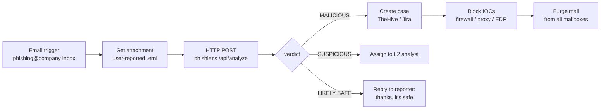

# Shuffle SOAR integration

PhishLens exposes a JSON endpoint, so it can act as the analysis step of an automated phishing-response playbook.

```
POST /api/analyze
Content-Type: multipart/form-data   (field: eml)   - or raw message bytes as the body
→ 200 application/json  { verdict, score, findings[], urls[], attachments[], mitre_techniques[], ... }
```

## Example playbook



## Shuffle steps

1. **Run PhishLens** where Shuffle can reach it:
   ```bash
   docker compose up -d       # exposes 127.0.0.1:5000 - change the bind if Shuffle runs on another host
   ```
2. **Trigger**: an *Email* (Outlook / Gmail app) or *Webhook* trigger that fires when a user forwards a mail to the reporting mailbox.
3. **Fetch the original** `.eml` attachment with the mail app's *get attachment* action.
4. **HTTP app → POST**
   - URL: `http://phishlens:5000/api/analyze`
   - Body: the file from step 3 (`eml` multipart field)
5. **Condition** on `$http_post.body.verdict`:
   - `MALICIOUS` → create a case with `$http_post.body.findings`, push `urls[].url` / `attachments[].sha256` to a blocklist, then purge.
   - `SUSPICIOUS` → notify the L2 channel.
   - `LIKELY SAFE` → auto-reply to the reporter.

## Useful JSON paths

| Path | Use |
|---|---|
| `verdict`, `score` | branching |
| `headers.originating_ip` | firewall block / AbuseIPDB |
| `urls[].domain`, `urls[].defanged` | proxy blocklist, case notes |
| `attachments[].sha256` | EDR hash ban, sandbox |
| `mitre_techniques` | case tags |
| `findings[]` (`severity`, `title`, `detail`) | analyst summary |
